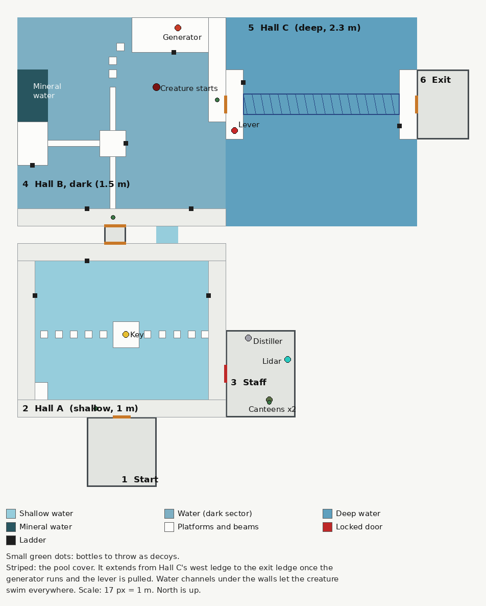

# RIPPLE — Design Doc

## Pitch

A co-op VR horror platformer set in the poolrooms: endless tiled halls of still,
clear water. You have to escape by climbing, jumping and balancing above the water.
Something lives in it, and it hunts by sound. If you fall in, it's coming.

## Scope

- **Platform:** Meta Quest standalone (Quest 3 / 3S)
- **Engine:** Godot 4
- **Setting:** the poolrooms
- **Players:** 1–4 co-op, fully playable solo
- **Structure:** separate levels, each one a section of the poolrooms to escape from
- **Goal of every level:** reach the exit
- **Water level:** fixed (it never rises or drains)
- **Assets:** no AI-generated assets (see Asset policy)

## Identity

What makes RIPPLE its own game:
- A creature that only hears the water, and ripples that show exactly what it hears
- Horror platforming, where the danger is falling in
- Dark sections where a lidar scanner is the only way to see
- Keys, levers, and generators that run on mineral water you have to carry without
  spilling, so progress is always a risk

The poolrooms are a well-known liminal space, and other co-op VR horror games use
similar spaces. RIPPLE uses its own version of the poolrooms, with no level numbers,
established lore or terms from those games. The mechanics carry the identity.

RIPPLE is also inspired by an existing poolrooms game with a creature that hears the
water. RIPPLE needs its own visual style and its own taglines and wall text, not
borrowed ones. The creature will be a ready-made model, so it should be retextured or
changed enough that it doesn't look like the inspiration game's creature or a stock
download.

## Core rules

1. **It hunts by sound in the water.** Anything that disturbs the water makes noise,
   and it hears it almost instantly.
2. **It can't leave the water.** Dry ground is safe.
3. **It's fast.** You can't outrun it once it's charging.
4. **Falling in is the main danger.** A fall is a big splash, and it almost always
   hears it and charges. Most of the game is spent above the water trying not to
   fall in.
5. **Going still is your best chance, not a sure thing.** When you stop moving, it
   only knows roughly where you were. It comes to that area and feels around with its
   arm. Even if you stay perfectly still, there's about a 30% chance the arm finds
   you. Any movement gives you away, even a flick of the wrist in the water or barely
   stepping forward (see "Searching by feel").

## Falling in

Falling in should be terrifying but survivable, or players will stop taking risks.

- **Fall height sets splash size.** A short slip off a low ledge is a medium splash.
  A fall from a diving tower is huge. Lowering yourself in slowly from a ledge is
  quiet.
- **"Almost always" hears you.** A fall goes unheard only if it's masked by loud
  machinery or an inlet pouring water, or the creature is far away or busy with a
  decoy.
- **Its distance is your escape window.** It charges from wherever it is, so how
  long you have depends on how far away it was. Its wake and sound cue tell you how
  close it is.
- **Don't stay where you landed.** A charge goes straight to the splash. If you're
  still on that spot when it arrives, it gets you. Climb out, or get clear of the
  spot and freeze.
- **There's always a way out nearby.** Pool ladders, low ledges, railings and pipes
  are placed so a fallen player can always reach one if they move immediately.
- **The edge isn't safe.** It can lunge about 1 m out of the water, so you have to
  climb all the way up, not just grab the edge.

## Platforming

Movement:
- **Walk and jump:** thumbstick movement plus a jump button
- **Climb:** grab ledges, railings, pipes and ladders with your hands and pull
  yourself up. This is the most natural kind of VR platforming and the most
  comfortable.
- **Mantle:** pull yourself up onto a ledge you're hanging from
- **Balance:** walk along narrow ledges and beams, physically if you have room

Platform types:
- **Narrow tiled ledges and pillar tops**
- **Diving boards and towers:** high up, so falls from them are the loudest
- **Floating inflatables and pool toys:** bob when you land on them and make small
  ripples
- **Wet, slippery tiles:** you slide if you move too fast
- **Cracked tiles:** give way after a moment, or if more than one player stands on
  them
- **Hanging pipes and light fittings:** swing or climb across
- **Broken pool ladders:** missing rungs you have to reach past
- **Water slides:** fast, and some end in the water
- **Powered platforms:** retractable pool covers that extend over the water as
  bridges, lifts, and moving platforms, switched on by levers and generators

Short wading sections through the shallow ends keep the stealth part alive:
sometimes there's no way around the water and you have to go through it slowly.

## Lidar scanner

A handheld scanner for dark sections. It sprays dots of light onto everything it
hits.

- **It's for the dark.** Some sections have the lights out until you restore power at
  a generator. Until then, the lidar is how you see platforms, gaps and the water.
- **Hold the trigger to scan.** Dots stick to walls, floors, the pool bottom and the
  creature, and fade after about 15 seconds.
- **It sees through the water.** Rays pass through the surface, so scanning a pool in
  the dark shows the bottom and anything in it.
- **It's a snapshot.** Dots don't move. The creature's dots show where it was when you
  scanned, not where it is now.
- **It's silent,** because the creature only hears the water. Drop it in the water and
  it makes a splash, and it's gone.
- **Limited battery.** Recharge it at charging points, which only work once their
  section has power.
- **One per team.** It's scarce, so who holds it matters and it gets handed around.
- **Only the holder sees the dots.** Everyone else relies on what the holder tells
  them.

## The creature

Built from the ready-made [The Rake](https://sketchfab.com/3d-models/the-rake-92898b04b24e4315b0673fcfe307f64e)
by Sealife Fan 3 (CC BY), reworked into RIPPLE's own "drowned" creature:

- **Dark, wet, realistic skin:** near-black creases, lighter ridges and an oily
  sheen, with pores and wrinkles taken from photographed leather
  ([Brown Leather](https://polyhaven.com/a/brown_leather), Poly Haven, CC0). Its
  shape still shows in low light.
- **Empty eye holes.** It has lived its whole life in dark water and hunts only by
  sound.
- **An unhinged jaw:** the jaw opens wider and stretches longer than a human jaw.
  Posed in the game by rotating and stretching the jaw bone.
- **A few toothy slits in its skin,** on the neck, forearm, shoulder and back, as
  decoration.
- **Twitchy listening movement:** sharp head tilts toward sounds, freezing mid-step,
  then sudden fast scuttling. Done in code on top of its own animations.
- **Long arms for feeling around.** When it can't pinpoint you, it sweeps one long arm
  through the water to find you by touch.
- **A gaunt, long-limbed shape** that uses the model's own animations (walk,
  run, idle, search, screech and more). Built with the scripts in `tools/creature/`.
- **A quarter taller than a player** (1.25x). In the shallow pools it
  stands upright and wades slowly, its legs stepping through the water (done in code,
  `game/creature/wade_modifier.gd`). It runs upright when it charges and crawls only
  in the deep channel.

### Kills

When it catches someone it grabs them, and kills them one of two ways (the host picks,
and everyone sees the same one):

- **Head and spine:** one hand on the shoulder, the other on the head. It pulls the
  head off with the spine still hanging from it, lifts it to its face, bites it and
  throws it. The body drops into the water, blood pumping from the neck.
- **Torn in half:** it lifts them with both hands and tears them apart at the waist.
  The intestines stretch between the halves and snap; the heart, lungs, liver,
  kidneys and stomach spill out and float or sink.

Each kill has its own screech (no two in a row are the same), tearing and bone
cracks, and bites. **The victim's view:** for the head and spine, the view blurs as it
pulls, then cuts to black. For torn in half, it cuts straight to black. Remains and
a spreading blood pool stay in the water for a while.

**Feeding:** after a kill it feeds on the remains for 3 to 5 seconds, chewing wetly,
and ignores every noise while it eats. That's the teammates' window to get away.

### Its voice

It clicks: deep, distorted throat clicks with only a short echo, and nothing human
in their tone. The clicks are its voice, not
how it finds you. It still hunts only by listening to the water. Its voice is 3D
positional audio, so you can tell where it is in the dark, and each state sounds
different:

- **Patrol:** slow wading, with a short burst of clicks now and then
- **Investigate:** steady clicking
- **Close by:** rattling clicks and teeth
- **Charge:** a death screech. This is the warning to get off the spot it's charging
  to.

The voice is mixed from CC0 recordings (throat clicks, a death rattle, teeth, recorded
screams, and dry ice on piano strings for an inhuman whine), changed in pitch and
layered. It must not copy the sound of any existing game's creature. Mixing script:
`tools/sound/`.

## Making a fast creature fair

1. **Going still gives you a chance.** You can't outrun it, but you can go silent.
   Once you stop, it only knows the area you were in and has to search it by feel.
2. **Small noises get investigated first.** The creature has escalating states:
   - **Patrol:** wanders slowly
   - **Investigate:** swims at medium speed to where a small noise came from
   - **Charge:** full speed, triggered by a big splash like a fall, or more noise
     near the spot it's investigating
   - **Search:** reaches the area where it last heard you and feels around with its
     arm (see below)
   - **Lose interest:** finds nothing after a few sweeps, goes back to patrolling

   Freezing when it starts investigating is the best way to survive a small noise. A
   fall usually skips straight to charge.
3. **It always gives itself away.** Each state has its own tells: a V-shaped wake,
   its back breaking the surface, bubbles, and a different sound cue per state. An
   attentive player always knows what it's doing. In dark sections, sound and the
   lidar are how you track it.
4. **It waits.** After you climb out, it circles nearby for a while, so going back
   into the water right away is a bad idea.

### Searching by feel

What happens when you go still in the water with the creature on its way:

- **It knows the area, not the spot.** It heads to roughly where it last heard you.
- **It feels around with its arm.** It stops at the surface and sweeps its long arm
  through the water around that area, a few passes over several seconds. Its close-by
  rattling clicks play the whole time.
- **The arm is the danger.** If the arm touches you, it has you. Even if you stay
  perfectly still, there's about a 30% chance it finds you. Otherwise it passes close
  by and moves on.
- **Don't move at all.** Even a tiny movement gives you away: a movement of the wrist
  in the water, or barely stepping forward. Your head and body count, and so do your
  hands while they're in the water.
- **You can hear it coming.** The arm makes small sloshes as it sweeps, so you can
  follow it in the dark. The lidar shows it too.
- **Teammates can help.** A decoy thrown elsewhere pulls it away mid-search.

## Noise

| Source | Noise |
|---|---|
| Falling in | Very loud, louder from higher up. Almost always triggers a charge. |
| Lowering yourself in slowly | Quiet |
| Standing still in the water | Silent |
| Moving your hands in the water | Makes noise, more the faster you move them. Only hand movement relative to your body counts: walking carries your hands along without extra noise (wading has its own). Hands out of the water are silent. |
| Any movement while it searches near you | Gives you away, even a tiny one (see "Searching by feel") |
| Wading slowly | Very quiet |
| Wading fast | Loud |
| Landing on a floating inflatable | Small ripples |
| Dropping an item into the water | Medium |
| Re-entering the water while dripping | Medium (you drip for a while after climbing out) |
| Throwing an object into the water | Loud, at the landing point (use as a decoy) |
| Spilling the canteen into the pool | Small splash |
| Interactions | See the interactables table |

**How fast it hears:** almost instantly. Only when it's very far away is there a
delay, of a few seconds at most.

**Cover noise:** filter pumps, water inlets, dripping ceilings, gurgling drains and
machinery that starts once a section has power all mask the noise you make. Some of
them run on a cycle, which gives you a window to do something loud.

**Haptics:** controller vibration matches how much noise you're making, so players
learn by feel.

## Interactables

Every interaction has a cost: noise, or a risky position above the water.

| Interactable | How it works | Noise |
|---|---|---|
| **Keys** | Locker and staff-door keys. Usually on hard-to-reach ledges. Some are on the bottom of the shallow end, so you have to wade in for them. Drop one and it sinks with a plop. Insert and turn in the lock. | Quiet if careful |
| **Locked doors** | Staff doors, gates, lockers. Opened with keys. Some are rusted or stuck and have to be forced. | Key: quiet. Forcing: loud |
| **Levers** | Pulled physically. Extend pool covers, lower platforms, open gates. Heavy ones clank. Some need two levers pulled at the same time by different players (solo version: wedge one with a crowbar). | Loud — time with cover noise or a decoy |
| **Generators** | Restore power to a section: lights, lidar charging points, pool covers and lifts. They run on mineral water: every generator takes 2 canteens of it, poured into the tank. Once running, their hum is cover noise. | Medium while starting up |
| **Mineral water** | Only certain patches of water carry the minerals that power generators. They're darker than the water around them and give off a soft teal glow. Fill the canteen there, which means reaching into the water. | Filling: quiet if slow |
| **Water canteen** | A physics object. It spills if you tip it, drop it or fall, and spilled water is lost. Getting it back across the platforms without spilling is part of the challenge. It can be handed to a teammate. | Spilling into the pool: small splash |
| **Distillers** | Found later in the game. Distilled mineral water makes a generator power on faster than normal, so you spend less time making startup noise. It still takes 2 canteens. | Quiet |
| **Throwables** | Broken tiles, bottles, rubber balls. Throw to make noise somewhere else. | Loud at the landing point |

Typical level chain: **find key → open the staff room to get the canteen → find the
mineral water → fill the canteen → carry it back without spilling → power the
generator → pull the lever to extend the pool cover → cross to the exit.**

## Levels

Each level is 15–25 minutes long, with dry rooms as checkpoints. All levels are
sections of the poolrooms.

1. **The shallow halls** — tutorial. Low ledges and shallow water. Teaches climbing,
   jumping, decoys, the lidar and what happens when you fall in.
2. **The deep end** — diving towers and high ledges over deep water. Falls are huge.
3. **The pump rooms** — machinery for cover noise, lots of generators and powered
   platforms.
4. **The dark sector** — lights out. Lidar-heavy until you restore power.
5. **The slides** — water slides, fast movement, the finale.

## Level 1: The Shallow Halls (test level)

The first playable level, built in the co-op demo in `game/`. It uses every core mechanic once,
in order, so a team learns them by playing.

| # | Room | Water | What happens | What it teaches |
|---|---|---|---|---|
| 1 | Start room | none | Plaque with the rules. Checkpoint. | The goal and the rules |
| 2 | Hall A | 0.65 m, shallow (the channel to Hall B is 1.5 m) | The staff room key is on an island in the middle of the pool, reached by stepping columns from either side, or by wading slowly. | Platforming, falling in, wading noise, going still |
| 3 | Staff room | none | Locked; the key opens it. Two canteens, the lidar on its charger, the distiller, bottles. Checkpoint. | Keys, items, decoys |
| 4 | Hall B, the dark sector | 0.65 m, shallow | Lights out. Narrow beams and stepping columns across the pool. The softly glowing mineral water is in the far corner beside a platform; the generator is on the far side. Two canteen trips (or two players with one canteen each). The generator is noisy while starting, then lights the room, powers the charger and masks noise nearby. | The lidar, mineral water, carrying the canteen, generators, distillers, co-op |
| 5 | Hall C | 0.65 m, shallow | The lever on the west ledge (loud) extends the pool cover across to the exit ledge, so you cross on dry ground. Wading the whole way is possible but very dangerous. | Timing a loud action, waiting for the creature to lose interest |
| 6 | Exit | none | The level ends when everyone is inside. | |

- **The creature** starts in Hall B. Water channels under the walls connect all three pools, so it
  can reach anyone in any pool, and it tends to patrol toward players near the water.
- **Ladders and grab edges:** every pool has ladders, and VR players can grab any pool edge or
  platform edge to pull themselves out.
- **Decoys:** four bottles, placed at the start of Hall A, in the staff room, at the Hall B
  entrance and on Hall C's ledge.
- **Co-op moments:** splitting the two canteen trips, one player scanning with the lidar while the
  other carries, throwing a decoy to pull the creature away from a teammate, and handing items over.

## Comfort

Platforming is the hardest thing to make comfortable in VR.

- Climbing is the main way to move between heights, because it's the most comfortable.
- Jumping is short and predictable, with an optional vignette while in the air.
- Water slides have an optional vignette and can be made slower in the comfort
  settings.
- Snap turn and smooth turn options.
- No forced camera movement. Falling into the water uses the player's real fall, with
  an optional vignette.

## Multiplayer

The only direct interaction between players is **giving items** and **pushing**.
Everything else is coordination through the level.

- **One creature, hears everyone.** One teammate's fall endangers the whole team.
- **Player look:** each player picks one of three suits (anti-radiation suit, black
  jumpsuit, scuba diver) and a color, and everyone sees it. In the game, a mask texture
  painted once per suit model decides which parts take the color, and a shader applies
  it. Only the suit choice and color value are sent over the network.
- **Matching hands:** the hands you see on yourself are recolored to match your suit's
  gloves, so you see the same hands your teammates see.
- **Avatar movement:** other players' bodies follow their real head and hand tracking
  (IK), with procedural leg movement.
- **Giving items:** hand over keys, the canteen (carefully), throwables and the lidar
  scanner.
- **Pushing:** players can shove each other, including near an edge. Knocking a
  teammate into the water, by accident or not, is part of the tension.
- **Indirect co-op:** two levers that must be pulled at the same time, one player
  making a decoy noise while another fills the canteen, the lidar holder calling out
  what they see.
- **Rescue:** when someone falls in, the team can throw a decoy to buy them time while
  they climb out.
- **Weight:** some cracked tiles only hold one player at a time.
- **Proximity voice chat.** Optional setting: your real voice and breathing reach the
  water through the mic.
- **Getting caught:** you're out until the team reaches the next dry checkpoint room,
  then you respawn. If everyone is caught, restart from the last checkpoint.
- **Solo:** every two-player task has a solo alternative.

## Tech

- **Engine:** Godot 4 (latest stable), OpenXR
- **VR toolkit:** Godot XR Tools for movement (direct movement, turning, jumping,
  climbing), picking up objects, and snap zones for keys and the canteen
- **Quest export:** Godot OpenXR Vendors plugin. Mobile renderer, or Compatibility if
  performance needs it.
- **Physics:** Jolt (built into Godot 4.4+), for stable climbing and platform physics
- **Networking:** Godot's built-in multiplayer (RPCs), host-authoritative. On the same
  network: ENet with LAN discovery. Online (0.9): room codes. The players' games connect
  peer-to-peer with WebRTC (Godot's webrtc-native extension, public STUN servers), and
  find each other by passing the offers through free public MQTT brokers on topics named
  after the code, so there is no server to run. When both networks are too strict
  for a direct connection (tested with simulated home routers, `tools/nat_sim.sh`), the
  game falls back to a TURN relay (ExpressTURN's free tier, 1 TB a month; its login is a
  repository secret written into release builds).
- **Voice chat:** Godot has no built-in voice chat, so this needs an addon or a custom
  setup with microphone capture. Still to be chosen.
- **Host-authoritative creature:** the creature AI runs on the host. Each player's
  game detects their own noise (falls, wading speed) and sends noise events to the
  host.
- **Noise model:** a noise event has an origin and a loudness, and gets quieter with
  distance. The creature hears it almost instantly, with a small delay that grows
  with distance (a few seconds at most, only when very far away). This keeps the AI
  predictable and cheap.
- **Lidar:** each frame while scanning, cast a batch of rays in a cone. Hits are
  written into a fixed-size ring buffer drawn with a MultiMeshInstance3D (small
  unshaded dots that fade over time). The creature has a collision shape on a layer
  the rays can hit. The water surface isn't on that layer, so rays pass through it. The dots are only drawn for the holder, so
  nothing needs to be sent over the network.
- **Water visuals:** a clear-water shader drawing ripple rings (the active ripples
  are passed to the shader as an array), cubemap reflections and caustics. No real-time
  reflections or GPU wave simulation, to stay fast on Quest.
- **"Can't leave the water":** the creature moves on a navigation mesh baked only over
  the water. The edge lunge is an attack with a fixed reach.
- **Searching by feel:** runs on the host. When a search starts, the host rolls the
  30% chance for each still player in the area and plans the arm's sweeps to either
  reach them or pass close by without touching. The arm is an IK chain driven along
  those sweeps, with a collision shape that catches players. While the creature is
  searching nearby, each player's game watches its own headset and hands (hands only
  while in the water, measured relative to the body) against a very small movement
  threshold, and sends a noise event the moment it's crossed.
- **Canteen:** the water is a fill level, not a fluid simulation. It drains while the
  canteen is tipped past an angle, faster the further it's tipped, with a small
  particle stream. Dropping it or falling empties some or all of it.
- **Audio:** 3D positional audio is essential. Half the game is hearing where it is.
  Tiled rooms should echo. Underwater muffling when your head goes under. Each area has
  a quiet looping ambience (lit halls with fluorescent hum, pump rooms, dark sectors
  with no hum), with drips and water placed around the room as 3D sounds. Music is
  slightly eerie and sparse, and stays quiet so it never hides the creature.
- **Performance target:** 72–90 Hz on Quest 3 / 3S.

## Asset policy

No AI-generated assets: no AI-made models, textures, images, sound effects, music or
voice.

- Assets are made by the team, or come from human-made libraries with a clear
  license that allows commercial use. CC0 is preferred; CC BY is fine with credit in
  the game. Examples: Kenney (CC0), Poly Haven (CC0), ambientCG (CC0), and Freesound
  (license varies per sound).
- Check each asset before using it. Some libraries now contain AI-made content.
- Every third-party asset goes in a credits file with its source, author and license.
- Early milestones use Godot's built-in shapes (boxes, planes, CSG), so no assets are
  needed until level art starts.

## Milestones

1. **Solo gray-box:** tiled platforms over a pool made from simple shapes. Walk, jump,
   climb. Falling in makes a splash, the creature (water-only navigation mesh)
   charges, pool ladders to climb out, getting caught, restart. *Done in the test demo.*
2. **Noise, stealth and lidar:** wading noise, going still, the investigate state, searching by
   feel, decoys, a dark section and the lidar scanner. *Done in the test demo, except floating
   inflatables.*
3. **Interactables:** key and door, lever, a generator with the canteen and mineral
   water, each with its noise cost. *Done in the test demo.*
4. **Multiplayer:** 2 players over LAN, creature runs on the host, shared noise,
   giving items and pushing. *Done in the test demo (up to 4 players).*
5. **Level 1:** the shallow halls, fully built with human-made art and audio. *The layout is in the
   test demo; the art is still gray-box.*
6. **Online play, voice chat, more levels, polish.**

## Open questions

- Is there any story?
- What's RIPPLE's own visual style (colors, lighting), so it doesn't share the
  inspiration game's look?
- Which online relay or matchmaking service?
- Which voice chat solution?
- Should mic noise (voice reaching the water) be on or off by default?
- Is 4 the max player count?
- How long does a dripping player stay noisy after climbing out?
- Should pushing a teammate into the water be possible, or turned off near edges?
- One lidar per team, or more in bigger groups?
