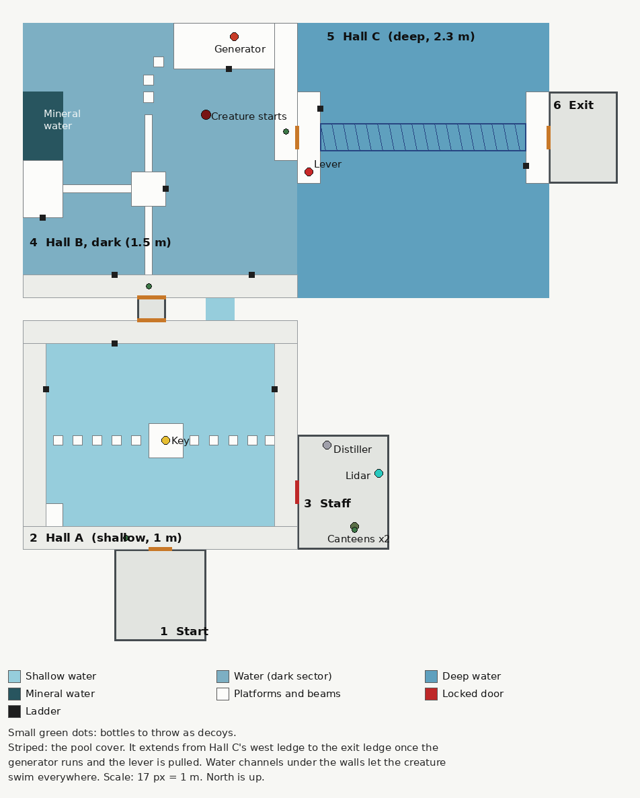

# RIPPLE: co-op test demo

One test level with every core mechanic, playable in VR or on a flat screen, alone or with up to
3 friends. Built in Godot 4.7.2 with Godot XR Tools.



## Run it on a PC

1. Download **Godot 4.7.2** (the standard version, not .NET) from
   [godotengine.org](https://godotengine.org/download/archive/4.7.2-stable/).
2. In the Godot Project Manager, choose **Import** and pick `game/project.godot` from this repo.
   The first time, Godot imports the assets, which takes a minute.
3. Press **Play** (F5).
   - **VR:** connect your Quest with **Link** or **Air Link** first, and make sure the Meta Quest
     Link app is your active OpenXR runtime (Meta Quest Link app: Settings, General, OpenXR
     Runtime). SteamVR headsets work too. The game starts in VR when it finds a headset.
   - **No headset:** it starts in desktop mode (keyboard and mouse), which is handy for testing.

## Play with a friend

Both of you need the game: either both open the project in Godot (clone this repo), or one of you
exports a build for the other (see below).

- **Same Wi-Fi or network:** one of you presses **Host a game**. The other sees "*name*'s game"
  under "Join a game on your network" and clicks it. If it doesn't appear, type the host's address
  on the keypad and press **Join this address**. The host's address is shown at the bottom of the
  menu ("This computer: ...") and at the top-left of the screen while hosting.
- **Different houses:** the easiest way is a free virtual network such as
  [Tailscale](https://tailscale.com/) or [ZeroTier](https://www.zerotier.com/). Both install it and
  join the same network, then the joining player types the host's Tailscale or ZeroTier address
  (for example `100.x.x.x`). Or the host forwards **UDP port 7777** on their router and shares
  their public IP address.
- **Firewall:** when Windows asks, allow Godot (or the exported game) on private networks. The game
  uses UDP port 7777, and UDP port 7778 to find games on your network.
- Up to 4 players. The host runs the creature, so if the host leaves, the game ends for everyone.
- VR and desktop players can play together.

## Controls

| | VR | Desktop |
|---|---|---|
| Move | Left stick | WASD (Shift to run: loud in water) |
| Turn | Right stick | Mouse |
| Jump | A or X | Space |
| Climb out of the water | Grab the pool edge or a ladder and pull | Space while facing the edge, or W on a ladder |
| Pick up | Grip | E |
| Use the held item (scan, pour, throw) | Trigger, or tip the canteen, or throw it | Left mouse |
| Dip the canteen in the water | Reach down with it | Hold right mouse (and crouch with Ctrl) |
| Give an item | Your teammate grabs it out of your hand | Your teammate presses E on it |
| Shove a teammate | Swing your hand into them | F |
| Drop | Let go of grip | Q |
| Leave | Close the game | Esc twice |

## The level

1. **Start room.** The plaque on the wall explains the rules.
2. **Hall A (shallow, 1 m).** The staff room key sits on an island in the middle of the pool. Jump
   the stepping columns to get it, or wade through the water slowly. Falling in is loud, and so is
   wading fast.
3. **Staff room.** Unlock it with the key. Inside: two canteens, the lidar scanner on its charger,
   the distiller, and bottles to throw as decoys.
4. **Hall B, the dark sector (1.5 m).** The lights are out. Scan with the lidar to find the narrow
   beams. The slightly darker water in the north-west corner is the mineral water: kneel at the
   platform's edge and dip a canteen in it, then carry it along the beams without spilling and pour
   it into the generator's funnel. It takes 2 canteens. Distilled water starts it faster. Starting
   the generator makes noise; once it runs, the lights come on and its hum masks your noise nearby.
5. **Hall C (deep, 2.3 m).** Pull the lever on the west ledge (loud) to extend the pool cover across
   the deep pool. Or swim, if you're brave.
6. **Exit.** The level ends when everyone gets here.

## The mechanics in this demo

- **The creature** lives in the water, hunts by sound and is fast. It can't leave the water: dry
  ground is safe. Small noises make it come and investigate. A fall, or more noise near where it's
  investigating, makes it charge, with clicks that speed up into a death screech.
- **Going still** when it arrives: it only knows roughly where you are, so it searches by feel
  around that area. Even if you stay perfectly still there's about a 30% chance it finds you. Any
  movement at all gives you away: your head, your body, or your hands in the water. Afterwards it
  lingers nearby for a while.
- **Noise:** falling in (louder from higher up), wading (faster is louder), moving your hands in the
  water (only hand movement relative to your body counts), dropping or throwing things into the
  water, spilling the canteen into the pool, the lever, and the generator starting up. Re-entering
  the water while still dripping is louder. Every noise in the water draws ripple rings for
  everyone to see. In VR, the controllers rumble with the noise you make.
- **Lidar:** only the holder sees the dots. It sees through the water, and shows the creature in red
  and teammates in yellow. The battery drains while scanning and recharges at the charger once the
  power is on.
- **Getting caught:** you respawn at the last dry room you passed through (a checkpoint).

## Quest standalone (no PC)

This needs Android export set up in Godot once:

1. In Godot's AssetLib tab, install **Godot OpenXR Vendors plugin** (version 5.x for Godot 4.6 and
   later) and enable it in Project Settings, Plugins.
2. Install a **JDK 17** and the **Android SDK**, and set their paths in Editor Settings, Export,
   Android. Download the export templates (Editor, Manage Export Templates).
3. Project, **Install Android Build Template**.
4. Project, Export, add an **Android** preset: turn on **Use Gradle Build**, set **XR Mode** to
   OpenXR, enable the **Meta** plugin under the vendors section, and give it a package name.
5. Export the APK and install it on each Quest with Meta Quest Developer Hub or
   `adb install ripple.apk`. Then one Quest hosts and the other joins over the same Wi-Fi.

## Export a build for a friend who doesn't have Godot

Editor, Manage Export Templates, Download. Then Project, Export, add **Windows Desktop**, and
Export Project. Send them the `.exe` and `.pck` together.

## Automated tests

The game can drive itself to check that everything works:

```bash
godot --headless --path game -- --desktop --host --autotest=smoke
```

```bash
godot --headless --path game -- --desktop --host --autotest=mechanics
```

The mechanics test falls into the pool, gets searched and caught, unlocks the door, fills and pours
both canteens, starts the generator, extends the pool cover and reaches the exit. For co-op, run a
host and a client at the same time:

```bash
godot --headless --path game -- --desktop --host --autotest=net_host
```

```bash
godot --headless --path game -- --desktop --join=127.0.0.1 --autotest=net_client
```

Add `--fakevr` instead of `--desktop` to build the VR rig without a headset.

## Not done yet

- It hasn't been played on a real headset yet. The VR rig is tested by forcing VR mode without one.
- Gray-box art. Other players are simple suited shapes in their color; the approved suits come later.
- The creature's search shows as its search animation while it circles the area; there's no
  separate arm-reaching animation yet.
- The creature doesn't lunge at the pool edge, so dry ground is always safe.
- No music yet (still being chosen), and no voice chat (use Discord or similar).

## Files

- `core/` session, noise, water and game state. `level/` the level, built from rectangles at load
  time. `player/` VR rig, desktop rig, avatars. `creature/` the creature. `items/` key, canteen,
  lidar, bottles, lever. `ui/` menu and on-screen text. `tests/` the automated tests.
- Third-party assets and their licenses: [CREDITS.md](CREDITS.md).
